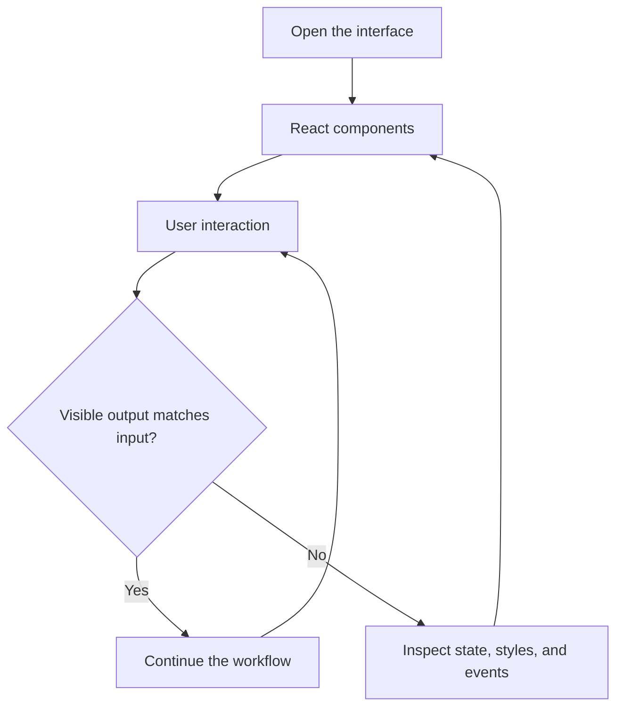

# Travel and Ride Booking — React Prototypes

Two React frontend experiments for travel and ride-booking interfaces.

## Project focus

React frontend prototype. Use the directory map to choose a focused example or learning topic instead of treating the repository as one application.

## Workflow



## Repository structure

| Path | Purpose |
| --- | --- |
| [`my-app/`](my-app) | Project-specific source, resources, or learning material. |
| [`my-react-app/`](my-react-app) | Project-specific source, resources, or learning material. |

## Getting started

```bash
git clone https://github.com/Raimal-Raja/Online-Ride-Booking-app-Using-ReactJS.git
cd Online-Ride-Booking-app-Using-ReactJS
```

Use a Node.js version compatible with the application manifest. Install and run inside one app directory.

```bash
cd my-app
npm install
npm start
```

The `my-app/` and `my-react-app/` directories are separate applications; repeat setup separately for the variant you want to inspect.

## Verification

Use the setup commands and inspect the selected interface, example, or notebook with known inputs. This documentation review checks repository paths and dependency declarations; it does not claim fresh end-to-end execution or model-quality measurements.

## Contributing

Include reproduction steps, the affected path, expected behavior, and the checks you ran. Keep credentials, generated environments, and unnecessary build artifacts out of commits.

## License

No top-level license file is currently tracked. Check reuse permissions with the repository owner.
